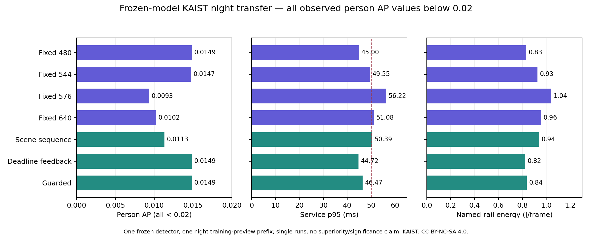
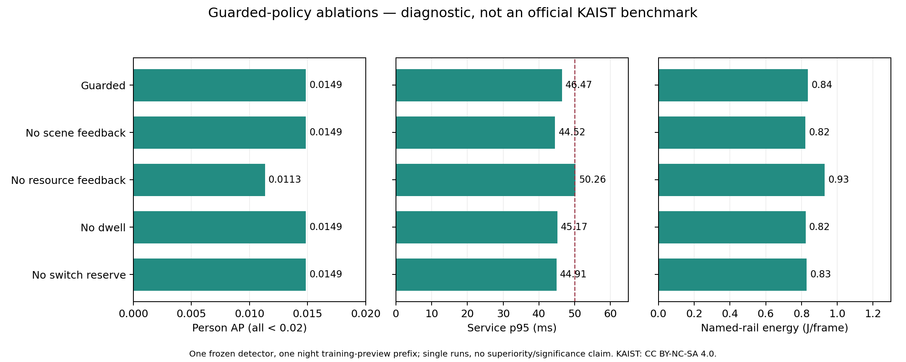

# Resource-aware resolution control for RGB/IR early-fusion detection

Working report draft — November 13, 2026. Results are preliminary; scope and
submission requirements await instructor review. This is not a submission-ready
claim of broad generalization.

## Research question and contribution

We investigate whether a causal resolution policy can improve the accuracy,
latency and energy tradeoff of RGB/IR detection under changing content and
resource availability. The detector consumes registered B,G,R,IR inputs. Its
resolution is chosen from 480, 544, 576 and 640 pixels using prior detections,
measured cost, or a fixed configuration.

The implemented contribution is a detector-adapter experiment framework with
per-frame stage timing, sampled Jetson rail energy, explicit streaming arrival
semantics, resource-pressure traces, and reproducibility records. An experimental
`guarded` policy caps the existing scene controller's preferred resolution with
online cost estimates, a 10% budget reserve, a 1 ms switch reserve, and four-frame
hysteresis. It gives budget feasibility priority over scene preference. These
parameters are provisional engineering choices, not learned or tuned on KAIST.
Ablations remove hysteresis or the switch reserve. Scene-only, resource-only,
AIMD, and fixed policies are compared separately. This method has not yet been
established across detector families or physical platforms.

## Hardware and deployment

The local platform is a Jetson AGX Orin Developer Kit, JetPack/L4T R36.4.7,
CUDA runtime 12.6 and TensorRT 10.3. The original environment uses CPU PyTorch
2.10. TensorRT executes the same exported detector on the GPU through the system
CUDA runtime, with the original CPU antialiased resize, channel order and
postprocessing preserved. System GPU libraries were not replaced. The strict
FP32 engine disables TF32 and supports dynamic spatial input shapes.

Numerical deployment validation matches detections by class and IoU rather than
row position, since TopK ordering can change. The sampled gate requires equal
counts at confidence >=0.10, matched IoU >=0.90 and score difference <=0.02.
It passed all 32 sampled frame/resolution combinations on the FLIR clip.
This is numerical validation, not proof of AP equivalence over a labeled test set.

## Data and evaluation conventions

The first pilot uses 120 unique indoor FLIR preview pairs, repeatedly replayed.
Its HTTP timestamps are host-arrival timestamps; they do not verify hardware
synchronization. Forty CPU runs processed 4,769 replay frames and 60 paired
warm switching trials. Those repeated observations are not independent scenes.

The official KAIST preview archive was verified against publisher MD5
`9f6f867d033d0c552888e9a213068ef1`. It contains 3,200 frames in night sequence
set04/V001, with 3,679 person boxes and 1,487 other human-like/uncertain regions.
It is an original training preview, not the official test set. The follow-up
uses a predefined first-1,200-frame prefix with frozen M3FD-trained weights and
controller; no target-data fitting is performed. Source coordinates are checked
against actual 640x512 images. Only model class People is scored. Other human-like
or uncertain categories are crowd-ignore regions. This COCO adaptation is not
the official KAIST reasonable-subset/log-average-miss-rate protocol.

Dataset: [KAIST source and license](https://github.com/SoonminHwang/rgbt-ped-detection).
The dataset is CC BY-NC-SA 4.0; retain publisher attribution and terms.

## Metrics and experiment design

Report service p50/p95/p99; preprocessing, GPU execution, transfer,
postprocessing and controller costs; configured-budget misses; dropped inputs;
output age; person AP/AP-small and recall at IoU .5/confidence .25; sampled rail
energy; and transition recovery/oscillation. Service cost includes decoding and
controller work; it is not identical to inference-only latency. Warmup/profile
wall time is reported separately and must be included in amortization arguments.
Engine-build wall time is retained in its deployment manifest. Startup energy
and complete training/profiling energy are not yet accounted for.

Offline evaluation processes every input in order. Realtime evaluation keeps
the latest due input and records skips and output age. One accuracy convention
scores skipped inputs without predictions. A second explicitly causal convention
uses the latest completed prediction at each recorded input arrival, without
tracking, interpolation or future predictions. It does not carry predictions
between independent sequences.

Resource tests separately apply owned CPU workers, GPU inference workers, or
bounded memory-bandwidth workers in the middle phase. GPU/memory workers use
CPU cores outside the inference set where available. No host clock/power mode
is changed. Clocks, temperatures, process memory and process snapshots are logged.

Rail energy integrates voltage-current products over monotonic timestamps.
The sum of named AGX Orin rails is not wall-plug or isolated model energy.
Background subtraction is an estimate and includes variation in other processes.
A calibrated external power cross-check remains outstanding.

Latency endurance repeats the FLIR clip 20 times per run, with five fresh-process
repetitions: 12,000 timed frames but only 120 unique source pairs. Confidence
intervals resample run-level statistics; they do not create independent content
or environment evidence. Short contention/transfer runs remain diagnostic.

## Initial CPU findings

Sequence-controller overhead averaged 0.514–0.531 ms in the two thread-trace
runs. Sequence service p95 was 176–223 ms and p99 192–241 ms, demonstrating
substantial run-to-run variation. Under CPU contention, AIMD remained at its
configured 480-pixel floor and missed every 120 ms service budget in that phase;
mean service cost was about 1,237 ms. This is a failure within the configured
action space, not a statement about every possible resolution or detector.

In pilot realtime replay, deadline feedback dropped 2 frames, scene sequence
control 5, and fixed-576 24. Ground-truth accuracy was unavailable for that indoor
clip, so throughput alone could not establish a winning method. Paired CPU
switching deltas varied in sign; the small pilot does not establish a universal
switch penalty.

GPU, labeled transfer, time-aligned accuracy, endurance and resource results are
reported in the accompanying November 13 results artifact when complete. Do not
substitute the CPU findings for those measurements.

## Limitations and remaining study

One detector family and one local physical platform are currently validated.
The KAIST preview adds a labeled night transfer check, not independent day/night
robustness. Full M3FD/KAIST/LLVIP split-controlled evaluation, trained additional
detector families, faithful published adaptive baselines, independent environments,
external power calibration and other physical platforms remain necessary for the
broad research claim. The authorized training workstation is 10.173.92.11;
SSH authentication must be configured before remote work can begin.

Relevant prior systems include [AdaScale](https://arxiv.org/abs/1902.02910),
[ApproxDet](https://arxiv.org/abs/2010.10754), and
[Chanakya](https://papers.nips.cc/paper_files/paper/2023/file/ae2d574d2c309f3a45880e4460efd176-Paper-Conference.pdf).
The implemented local policies are not faithful reproductions of those systems.

## Reproducibility and conclusion

Preserve checkpoint, engine, graph, source, dataset and annotation hashes;
raw per-frame predictions and timing; power samples; job order; and environment
metadata. Separate target-data fine-tuning from zero-shot transfer and hardware
calibration. Report failures and ties, not only favorable averages. The evidence
currently supports a working, instrumented research prototype; broader efficiency,
robustness and generalization claims depend on the remaining experiments.

## November 13 measured follow-up

See [GPU report](../../results/processed/orin_followup_20261113/REPORT.md) for all 29 runs, 31,044 processed frames, stage tables, raw-file hashes and ablations. Five endurance runs produced a mean run p99 of 39.85 ms, a controller mean of 0.553 ms and named-rail energy of 0.676 J/frame. The run-level 95% bootstrap interval for mean run p99 was 39.66–40.11 ms; this is not a cross-scene interval.

The frozen detector transferred poorly to the KAIST preview: person AP was about 0.009–0.015 across the main configurations. That absolute result prevents any robustness claim, regardless of serving speed. No target-label fitting was done. The preliminary guarded-policy variants do not establish broad superiority.

Numerical validation was extended to native KAIST shapes, including a lower-confidence gate. Process-cold startup was measured separately: initialization about 289–310 ms and first inference about 59–67 ms with caches retained. Complete measurements and exact definitions are in the linked report.

## Measured figures

Figures use the KAIST preview, CC BY-NC-SA 4.0, Soonmin Hwang et al.
They are descriptive single-run configurations on one night prefix, not official
KAIST test results or statistically established improvements.
