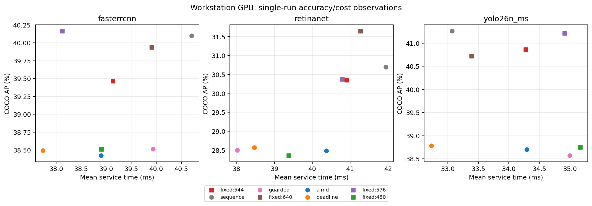
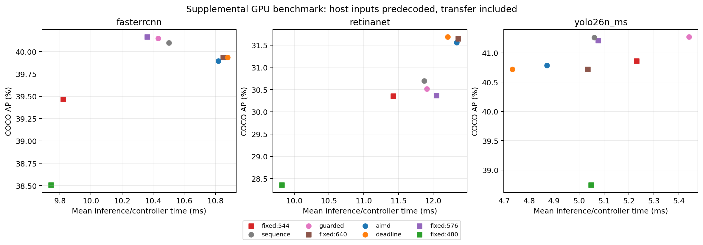
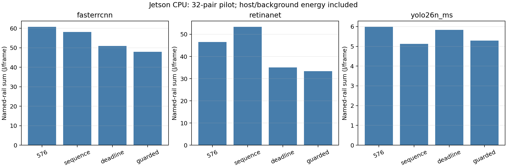

# Cross-family adaptive resolution — November 16, 2026

Completed 24 primary disk-replay and 24 supplemental buffered-input workstation GPU cases (20,112 timed frames), plus 12 Jetson CPU cost cases (384 timed frames). No model/controller fitting or policy selection used the resulting test scores.

## Workstation GPU: same grouped M3FD inputs

419 test pairs per case, grouped and ordered by original ID within group. Common 25 ms service budget; warmup excluded. Table shows AP, measured mean/p95 service cost and deadline misses. One trial per case, on a shared workstation.

| Model | Policy | AP % | Mean ms | p95 ms | Miss % | Mean resolution |
|---|---|---:|---:|---:|---:|---:|
| fasterrcnn | aimd | 38.42 | 38.90 | 46.54 | 85.2 | 494.8 |
| fasterrcnn | deadline | 38.49 | 37.73 | 45.93 | 85.2 | 486.9 |
| fasterrcnn | fixed:480 | 38.51 | 38.90 | 46.78 | 85.4 | 480.0 |
| fasterrcnn | fixed:544 | 39.47 | 39.13 | 46.82 | 86.6 | 544.0 |
| fasterrcnn | fixed:576 | 40.16 | 38.12 | 45.42 | 85.4 | 576.0 |
| fasterrcnn | fixed:640 | 39.94 | 39.91 | 47.48 | 86.9 | 640.0 |
| fasterrcnn | guarded | 38.51 | 39.94 | 47.77 | 86.6 | 483.4 |
| fasterrcnn | sequence | 40.10 | 40.71 | 48.46 | 87.8 | 594.6 |
| retinanet | aimd | 28.48 | 40.37 | 47.12 | 87.4 | 489.1 |
| retinanet | deadline | 28.57 | 38.47 | 47.53 | 86.2 | 484.7 |
| retinanet | fixed:480 | 28.36 | 39.38 | 47.07 | 88.1 | 480.0 |
| retinanet | fixed:544 | 30.35 | 40.91 | 48.09 | 88.5 | 544.0 |
| retinanet | fixed:576 | 30.37 | 40.79 | 48.11 | 85.9 | 576.0 |
| retinanet | fixed:640 | 31.65 | 41.27 | 49.35 | 88.3 | 640.0 |
| retinanet | guarded | 28.49 | 38.02 | 45.62 | 86.9 | 484.2 |
| retinanet | sequence | 30.69 | 41.94 | 48.73 | 88.3 | 598.1 |
| yolo26n_ms | aimd | 38.70 | 34.29 | 42.68 | 84.5 | 495.0 |
| yolo26n_ms | deadline | 38.78 | 32.73 | 40.40 | 84.5 | 493.1 |
| yolo26n_ms | fixed:480 | 38.75 | 35.17 | 43.06 | 85.9 | 480.0 |
| yolo26n_ms | fixed:544 | 40.86 | 34.28 | 41.70 | 84.5 | 544.0 |
| yolo26n_ms | fixed:576 | 41.21 | 34.92 | 42.30 | 85.0 | 576.0 |
| yolo26n_ms | fixed:640 | 40.72 | 33.39 | 41.08 | 83.3 | 640.0 |
| yolo26n_ms | guarded | 38.57 | 35.00 | 43.26 | 85.7 | 487.7 |
| yolo26n_ms | sequence | 41.26 | 33.07 | 40.36 | 84.5 | 590.7 |

### Pipeline bottleneck at fixed 576

PNG input reading/decoding dominates this workstation disk-replay pipeline. The 25 ms service budget is largely infeasible even before policy improvements. These service times are not detector-only GPU latency or camera streaming latency. CSV files separate mean decode, detector and controller costs.

- fasterrcnn: mean decode/read 27.34 ms; detector 10.72 ms; controller 0.060 ms.
- retinanet: mean decode/read 28.46 ms; detector 12.26 ms; controller 0.070 ms.
- yolo26n_ms: mean decode/read 28.56 ms; detector 6.29 ms; controller 0.062 ms.

### Frozen sequence controller versus fixed 576

- fasterrcnn: AP change -0.07 percentage points; mean service cost change +6.8%. Descriptive single-run comparison.
- retinanet: AP change +0.32 percentage points; mean service cost change +2.8%. Descriptive single-run comparison.
- yolo26n_ms: AP change +0.05 percentage points; mean service cost change -5.3%. Descriptive single-run comparison.

## Supplemental GPU benchmark: predecoded host inputs

Declared after observing the disk-decoding bottleneck. All 419 native BGRIR arrays are loaded into host RAM before timing; prefetch time/bytes are recorded separately. Same checkpoints, policies and 25 ms budget; no retuning. This isolates inference/controller/H2D costs and is not end-to-end camera latency.

| Model | Policy | AP % | Mean ms | p95 ms | Miss % | Mean resolution |
|---|---|---:|---:|---:|---:|---:|
| fasterrcnn | aimd | 39.90 | 10.82 | 11.27 | 0.0 | 639.4 |
| fasterrcnn | deadline | 39.94 | 10.88 | 11.33 | 0.0 | 639.2 |
| fasterrcnn | fixed:480 | 38.51 | 9.74 | 10.23 | 0.0 | 480.0 |
| fasterrcnn | fixed:544 | 39.47 | 9.82 | 10.12 | 0.7 | 544.0 |
| fasterrcnn | fixed:576 | 40.16 | 10.36 | 10.83 | 0.0 | 576.0 |
| fasterrcnn | fixed:640 | 39.94 | 10.85 | 11.31 | 0.0 | 640.0 |
| fasterrcnn | guarded | 40.15 | 10.43 | 11.04 | 0.0 | 592.5 |
| fasterrcnn | sequence | 40.10 | 10.50 | 11.09 | 0.0 | 594.6 |
| retinanet | aimd | 31.56 | 12.34 | 15.27 | 1.9 | 632.5 |
| retinanet | deadline | 31.68 | 12.21 | 12.35 | 0.2 | 637.1 |
| retinanet | fixed:480 | 28.36 | 9.82 | 10.24 | 0.7 | 480.0 |
| retinanet | fixed:544 | 30.35 | 11.42 | 15.20 | 0.0 | 544.0 |
| retinanet | fixed:576 | 30.37 | 12.04 | 15.48 | 0.2 | 576.0 |
| retinanet | fixed:640 | 31.65 | 12.36 | 12.36 | 0.2 | 640.0 |
| retinanet | guarded | 30.51 | 11.91 | 12.72 | 0.0 | 593.9 |
| retinanet | sequence | 30.69 | 11.87 | 12.54 | 0.0 | 598.1 |
| yolo26n_ms | aimd | 40.79 | 4.87 | 5.32 | 0.0 | 639.4 |
| yolo26n_ms | deadline | 40.72 | 4.73 | 5.33 | 0.0 | 639.2 |
| yolo26n_ms | fixed:480 | 38.75 | 5.05 | 5.41 | 0.7 | 480.0 |
| yolo26n_ms | fixed:544 | 40.86 | 5.23 | 5.51 | 0.7 | 544.0 |
| yolo26n_ms | fixed:576 | 41.21 | 5.08 | 5.15 | 1.0 | 576.0 |
| yolo26n_ms | fixed:640 | 40.72 | 5.03 | 5.50 | 0.2 | 640.0 |
| yolo26n_ms | guarded | 41.27 | 5.44 | 5.64 | 0.7 | 590.2 |
| yolo26n_ms | sequence | 41.26 | 5.06 | 5.50 | 0.0 | 590.7 |

## Jetson CPU: short unannotated indoor replay

32 unique recorded FLIR pairs per case; all three detectors run with CPU PyTorch, four threads on cores 8–11. Budget is 1,000 ms for this CPU pilot. CPU results are separate from prior YOLO TensorRT GPU measurements. No new-family Jetson GPU deployment is claimed.

| Model | Policy | Mean ms | p95 ms | Controller ms | Named rail sum J/frame | Miss % |
|---|---|---:|---:|---:|---:|---:|
| fasterrcnn | deadline | 1832.42 | 2197.13 | 0.142 | 50.960 | 100.0 |
| fasterrcnn | fixed:576 | 2244.83 | 2433.90 | 0.118 | 60.735 | 100.0 |
| fasterrcnn | guarded | 1712.54 | 1922.55 | 0.581 | 47.864 | 100.0 |
| fasterrcnn | sequence | 2094.48 | 2459.94 | 0.561 | 58.100 | 100.0 |
| retinanet | deadline | 1271.56 | 1659.91 | 0.154 | 35.089 | 100.0 |
| retinanet | fixed:576 | 1727.75 | 1973.22 | 0.144 | 46.495 | 100.0 |
| retinanet | guarded | 1206.77 | 1404.24 | 0.609 | 33.383 | 90.6 |
| retinanet | sequence | 1928.10 | 2248.79 | 0.597 | 53.381 | 100.0 |
| yolo26n_ms | deadline | 215.11 | 297.02 | 0.136 | 5.829 | 0.0 |
| yolo26n_ms | fixed:576 | 222.20 | 322.35 | 0.114 | 5.987 | 0.0 |
| yolo26n_ms | guarded | 197.90 | 351.79 | 0.572 | 5.293 | 0.0 |
| yolo26n_ms | sequence | 202.92 | 455.02 | 0.511 | 5.122 | 0.0 |

## Interpretation and limits

- These are actual serial inference runs, not selection from future predictions or cached costs. Fixed resolutions are 480, 544, 576 and 640. Sequence, guarded, deadline EMA and AIMD use only past predictions/costs. Policies and configurations were saved before execution; job order was randomized with seed 20261116.
- The same frozen YOLO-derived scene controller is transferred unchanged across families. Warmup cost profiles use one validation frame on the workstation; they do not fit to test labels. Jetson cost-only warmup uses the first unannotated indoor pair.
- M3FD has 218 short/static test groups. Scene history resets at group changes; group ordering does not establish true video continuity. Resource-cost history may persist across groups. Most groups are shorter than the sequence controller interval, limiting adaptation opportunities.
- The fixed-resolution test scores were already examined before this study. This is a predeclared follow-up on the same test split, not a new independent holdout. No parameters were changed based on these outcomes.
- Local EMA/AIMD/guarded implementations are engineering baselines, not faithful reproductions of published adaptive systems. One run per case does not establish statistical superiority, stable p99 or robustness across environments.
- Service includes decoding, policy choice/update, detector preprocessing/inference/postprocessing and synchronization. Outer result-record serialization is excluded from per-frame service but included in run energy. Controller timing also includes the finite-output check. Quadratic cost projection across resolutions can be inaccurate for detector-specific proposal/ROI work.
- Model preprocessing and training budgets differ. No architecture-superiority conclusion follows from the absolute AP ranking.
- Jetson CPU data have no detection labels. Named-rail integrals include dashboard/camera/background workload; they are neither isolated model energy nor wall-plug power. Rail-level values and samples are preserved. Profiles/model loading are outside the timed energy window.
- Shared-host load, thermal state and ordered jobs confound small runtime differences. The CPU pilot uses only 32 frames per case, so its percentiles are exploratory. No matched CPU-versus-GPU speedup or continuous-video streaming claim is made.
- Next: validate GPU exports of the additional families on Jetson, run longer repeated cost experiments, and evaluate all families on labeled continuous video and real environment transitions.

## Reproduction and artifacts

Source entrypoint: `experiments/adaptive_study.py`. Each copied plan freezes inputs, models, controller, budget, CPU threads and job order seed. Use the same plan with a NEW output directory:

```bash
python -m experiments.adaptive_study --plan /path/to/plan.json --output /NEW/output
```

For the recorded CPU affinity, prefix the Jetson command with `taskset -c 8-11`. For GPU execution, set CUDA_VISIBLE_DEVICES to the assigned GPU UUID. Check available resources first and preserve completed outputs.

Workstation raw data: /media/imsel/4TBSSD/EMCH585_Artifacts/adaptive_workstation_20261116

Jetson raw data: /media/imsel/4TBSSD/EMCH585_Artifacts/adaptive_jetson_cpu_20261116/runs

Buffered raw data: /media/imsel/4TBSSD/EMCH585_Artifacts/adaptive_buffered_20261116

Raw files retain per-frame native detections, resolution choices, controller/decode/inference timings, switching, warmup profiles and rail samples. Source snapshots preserve the primary implementation and its later predecode extension separately. See raw_index.json for hashes and validation.json for integrity checks.

## Figures






