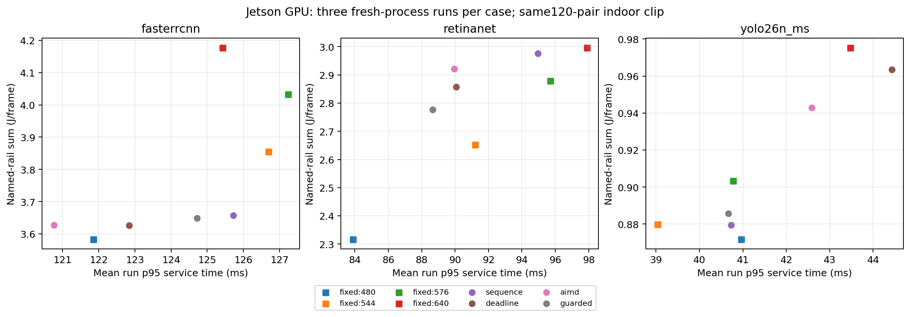
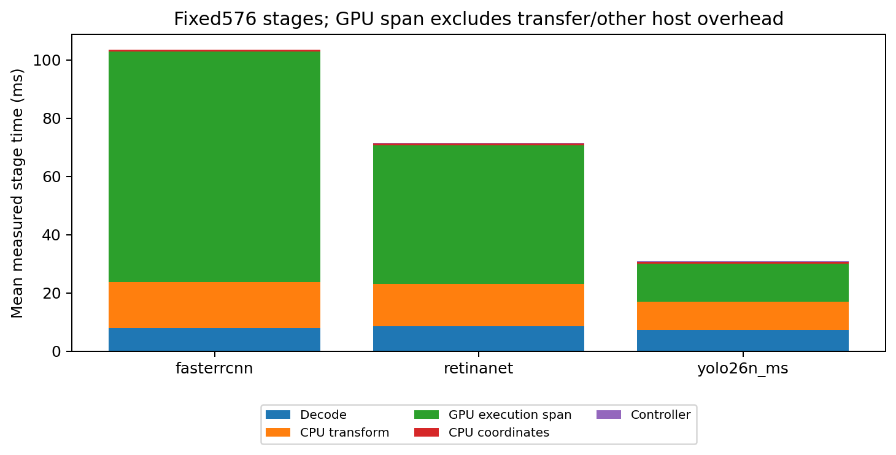

# Jetson GPU deployment of three detector families — November 16, 2026

Both frozen four-channel additional-family models were exported to ONNX and built as TensorRT 10.3 strict-FP32/no-TF32 engines on Jetson AGX Orin. The complete CNN, proposal/ROI heads and NMS run on GPU; original CPU transforms and native-coordinate restoration remain outside the engine. Existing YOLO26n is measured alongside them.

## Prediction validation

The primary predeclared gate requires identical class-aware detection counts at confidence 0.10, IoU≥0.90 and score difference≤0.02. Each model was compared at four resolutions on 12 M3FD validation pairs, 4 indoor FLIR pairs and one zero-image edge case: 68 comparisons per model.

| Model | Passed cases | Matched detections | Minimum matched IoU | Maximum score error | Largest validation AP difference (points) |
|---|---:|---:|---:|---:|---:|
| fasterrcnn | 68 | 715 | 0.999988 | 7.00355e-06 | 0.0141 |
| retinanet | 68 | 3102 | 0.999982 | 8.04663e-07 | 0.0000 |

Labeled AP comparisons use only the 12 selected M3FD validation pairs, separately at each resolution. This is sampled numerical/backend validation, not proof of full-test AP equivalence or environmental robustness.

Supplemental low-confidence diagnostic: positive-area boxes retain the original IoU/count/score gate; clipped zero-area boxes are compared by class, count and coordinates within 0.01 pixel, with the same score tolerance. This resolves undefined-IoU bookkeeping without changing models, thresholds or the primary gate. The original diagnostics remain saved.

```json
[
  {
    "model": "retinanet",
    "cases": 68,
    "passed_by_threshold": {
      "0.1": 68,
      "0.01": 68,
      "0.001": 68
    },
    "zero_area_coordinate_tolerance_pixels": 0.01
  },
  {
    "model": "fasterrcnn",
    "cases": 68,
    "passed_by_threshold": {
      "0.1": 68,
      "0.01": 68,
      "0.001": 68
    },
    "zero_area_coordinate_tolerance_pixels": 0.01
  }
]
```

## Repeated latency/controller/energy measurements

72 fresh-process runs: 3 detectors × 8 policies × 3 repetitions, each on the same 120 recorded indoor RGB/IR pairs (8,640 timed frames total). Warmup, model loading and profiling are excluded. All use a 100 ms offline service budget, 4 CPU threads pinned to cores8–11, the same frozen sequence controller and randomized job order.

| Model | Policy | Mean service ms | Mean run p95 ms | Mean run p99 ms | Controller ms | Named-rail J/frame | Budget misses % |
|---|---|---:|---:|---:|---:|---:|---:|
| fasterrcnn | aimd | 101.18 | 120.76 | 138.47 | 0.125 | 3.628 | 45.0 |
| fasterrcnn | deadline | 102.70 | 122.84 | 136.15 | 0.153 | 3.626 | 52.8 |
| fasterrcnn | fixed:480 | 100.96 | 121.85 | 128.41 | 0.123 | 3.584 | 47.5 |
| fasterrcnn | fixed:544 | 105.57 | 126.70 | 142.55 | 0.133 | 3.855 | 72.2 |
| fasterrcnn | fixed:576 | 108.09 | 127.24 | 148.76 | 0.121 | 4.033 | 75.8 |
| fasterrcnn | fixed:640 | 106.97 | 125.43 | 148.01 | 0.129 | 4.177 | 73.3 |
| fasterrcnn | guarded | 101.61 | 124.72 | 141.62 | 0.629 | 3.649 | 46.7 |
| fasterrcnn | sequence | 103.05 | 125.72 | 147.48 | 0.641 | 3.658 | 51.4 |
| retinanet | aimd | 76.20 | 89.95 | 113.56 | 0.138 | 2.922 | 3.1 |
| retinanet | deadline | 75.07 | 90.07 | 112.61 | 0.161 | 2.857 | 3.1 |
| retinanet | fixed:480 | 66.91 | 83.87 | 105.44 | 0.120 | 2.317 | 2.5 |
| retinanet | fixed:544 | 71.87 | 91.20 | 115.50 | 0.124 | 2.652 | 3.3 |
| retinanet | fixed:576 | 75.38 | 95.69 | 117.41 | 0.125 | 2.880 | 4.2 |
| retinanet | fixed:640 | 77.73 | 97.89 | 120.06 | 0.125 | 2.996 | 5.0 |
| retinanet | guarded | 74.00 | 88.65 | 115.35 | 0.660 | 2.776 | 3.9 |
| retinanet | sequence | 77.46 | 94.96 | 116.90 | 0.607 | 2.976 | 4.4 |
| yolo26n_ms | aimd | 34.64 | 42.58 | 47.56 | 0.121 | 0.943 | 0.0 |
| yolo26n_ms | deadline | 35.22 | 44.43 | 50.22 | 0.162 | 0.963 | 0.0 |
| yolo26n_ms | fixed:480 | 32.46 | 40.96 | 48.31 | 0.121 | 0.872 | 0.0 |
| yolo26n_ms | fixed:544 | 32.47 | 39.04 | 43.59 | 0.120 | 0.880 | 0.0 |
| yolo26n_ms | fixed:576 | 33.79 | 40.78 | 45.39 | 0.119 | 0.903 | 0.0 |
| yolo26n_ms | fixed:640 | 35.49 | 43.47 | 48.12 | 0.121 | 0.975 | 0.0 |
| yolo26n_ms | guarded | 32.95 | 40.67 | 46.28 | 0.588 | 0.886 | 0.0 |
| yolo26n_ms | sequence | 32.65 | 40.73 | 47.07 | 0.546 | 0.879 | 0.0 |

CSV includes per-case p95 ranges, stage means, mean resolution and switches. Percentiles shown are means of run-level percentiles; three repeats describe local repeat variation, not independent scenes or reliable population confidence intervals.

## Scope and limits

- All models use the same frozen checkpoints previously tested. No training, class-map changes, score-threshold fitting, power-mode changes or live-camera movement occurred.
- TensorRT executes complete exported detection graphs, including ROI processing and suppression; this is not a CPU detector reported as GPU. Input normalization/resize/padding and coordinate conversion are CPU operations. CUDA events measure the execution span, including possible host/device shape synchronization gaps; they are not isolated kernel-active time.
- The export pads outputs to 300 detections with zero-score rows discarded afterwards. It replaces an unsupported empty-NMS If branch with negative-score dummy padding and specifies known Faster R-CNN classifier dimensions for empty-ROI reshapes. No learned weights or thresholds change. Export helper tests and numerical gates protect these transformations.
- RetinaNet low-confidence diagnostics initially show 16 IoU-only matching failures at 0.01/0.001 despite equal counts: the reference outputs contain clipped zero-area boxes, for which IoU is undefined. These are retained separately from the primary 0.10 gate; no arbitrary low-confidence AP equivalence is claimed.
- The cost clip is unannotated. Lower latency/energy at lower resolution does not establish an acceptable accuracy tradeoff. Learned sequence/guarded controllers and EMA/AIMD baselines are local implementations, not faithful reproductions of published adaptive systems.
- Named-rail sums include background acquisition/dashboard and other host load; they are neither wall-plug energy nor isolated model power. Rail traces/errors are retained. Services remained active. Hardware mode, clocks, temperatures and source hashes are recorded per run.
- Only 120 unique indoor pairs appear in every repetition. Tail percentiles from 120-frame runs remain preliminary. Offline budget misses do not measure real-time output age, dropped live frames, resource-transition recovery or multi-environment robustness.
- Service time includes the harness phase-setup/telemetry work at three boundaries. The 4,4,4 thread trace is constant; phase flags are bookkeeping, not actual resource changes. Per-frame setup_ms is retained. Controller cost includes output-finiteness checking plus policy choice/update. Instrumentation can influence short-run tails.
- Engines are target-specific. Rebuild for another TensorRT/device environment and repeat prediction validation before using those timings.

## Artifacts and reproduction

Raw exports, engines, build logs, validation inputs/references and per-frame timing/rail samples: /media/imsel/4TBSSD/EMCH585_Artifacts/family_trt_20261116

Source snapshots and plan hashes preserve exact measurement inputs. See `raw_index.json` and `validation.json`. ONNX/engine hashes and complete builder commands are in each engine.json.

```bash
# From the project root, with matching native TensorRT bindings:
bash scripts/gpu_python.sh -m experiments.run \
  --manifest captures/research_flir_pilot/manifest.json --output /NEW/result.json \
  --weights /path/to/validated/engine.json --adapter experiments.family_trt_backend:create \
  --device tensorrt --policy sequence --thread-trace 4,4,4 --budget-ms 100
```

Full matrix: `python -m experiments.benchmark_family_trt --plan /path/to/benchmark_plan.json --output /NEW/output`. It refuses engines whose saved numerical gate does not pass or whose hashes differ.

Next: longer labeled continuous-video evaluation with scene/resource transitions and held-out environments.

## Figures




