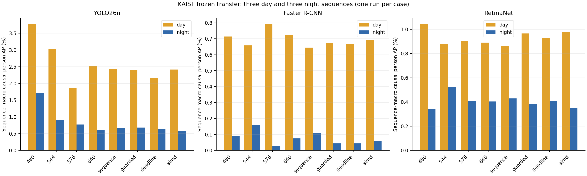
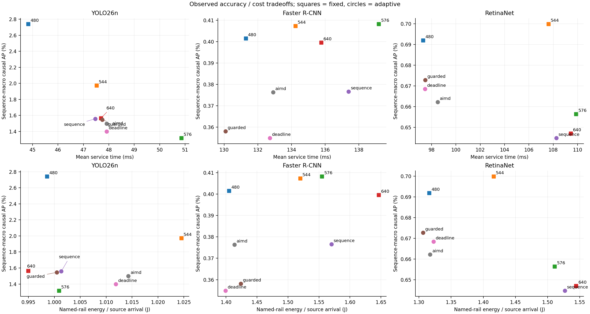
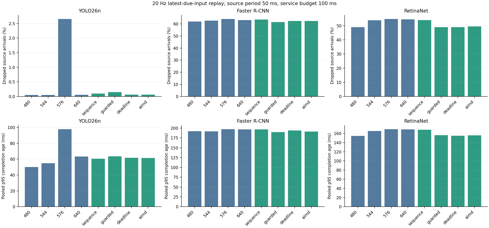

# KAIST full-video analysis — November 19, 2026

All 162 cases completed and their saved evidence was verified. The study uses three frozen M3FD-trained models on six full KAIST sequences (three day, three night), 16,873 unique paired images, and 455,571 source-frame evaluations. This analysis is post-hoc; no model, threshold or controller was fitted to these results.

## Findings

- **yolo26n_ms:** highest observed fixed-resolution macro AP is 2.742% at fixed:480; frozen sequence / guarded AP is 1.558% / 1.546%. Sequence / guarded source drops are 0.09% / 0.15%.
- **fasterrcnn:** highest observed fixed-resolution macro AP is 0.408% at fixed:576; frozen sequence / guarded AP is 0.377% / 0.358%. Sequence / guarded source drops are 63.61% / 61.57%.
- **retinanet:** highest observed fixed-resolution macro AP is 0.700% at fixed:544; frozen sequence / guarded AP is 0.645% / 0.673%. Sequence / guarded source drops are 54.06% / 49.03%.

The data do not show a consistent adaptive advantage across detector families. Absolute person AP is low under this frozen cross-dataset transfer. The best observed fixed setting is a descriptive test result, not a validation-selected policy or a newly recommended deployment setting.

## Fixed and adaptive policies

AP is the equal-weight mean of six per-sequence **causal** COCO AP scores, in percent; it is not a pooled COCO score. Day/night AP averages three sequences each. Service and controller means weight completed inferences. Drops weight source arrivals. P95 values below pool the actual samples across all six sequences, rather than averaging six percentiles.

| Model | Policy | AP % | Day AP % | Night AP % | Worst AP % | Mean service ms | p95 service ms | p95 completion age ms | Drops % | J/source | J/completed |
|---|---|---:|---:|---:|---:|---:|---:|---:|---:|---:|---:|
| fasterrcnn | aimd | 0.376 | 0.694 | 0.059 | 0.000 | 132.91 | 159.17 | 191.25 | 62.40 | 1.414 | 3.760 |
| fasterrcnn | deadline | 0.355 | 0.665 | 0.044 | 0.000 | 132.72 | 162.21 | 193.97 | 62.35 | 1.399 | 3.716 |
| fasterrcnn | fixed:480 | 0.402 | 0.714 | 0.089 | 0.000 | 131.29 | 159.82 | 192.04 | 61.93 | 1.405 | 3.690 |
| fasterrcnn | fixed:544 | 0.407 | 0.658 | 0.157 | 0.000 | 134.23 | 158.90 | 191.80 | 62.77 | 1.520 | 4.082 |
| fasterrcnn | fixed:576 | 0.408 | 0.789 | 0.027 | 0.000 | 139.18 | 164.10 | 197.07 | 64.08 | 1.555 | 4.328 |
| fasterrcnn | fixed:640 | 0.400 | 0.723 | 0.076 | 0.000 | 135.77 | 164.77 | 196.83 | 63.18 | 1.646 | 4.471 |
| fasterrcnn | guarded | 0.358 | 0.672 | 0.044 | 0.000 | 130.09 | 157.14 | 190.03 | 61.57 | 1.424 | 3.705 |
| fasterrcnn | sequence | 0.377 | 0.644 | 0.110 | 0.000 | 137.40 | 163.29 | 196.82 | 63.61 | 1.570 | 4.315 |
| retinanet | aimd | 0.662 | 0.976 | 0.348 | 0.008 | 98.50 | 118.78 | 155.93 | 49.56 | 1.317 | 2.612 |
| retinanet | deadline | 0.668 | 0.929 | 0.408 | 0.007 | 97.46 | 117.44 | 155.12 | 49.07 | 1.323 | 2.597 |
| retinanet | fixed:480 | 0.692 | 1.040 | 0.344 | 0.007 | 97.29 | 117.68 | 154.69 | 48.97 | 1.316 | 2.579 |
| retinanet | fixed:544 | 0.700 | 0.875 | 0.525 | 0.012 | 107.61 | 129.90 | 165.35 | 53.84 | 1.416 | 3.067 |
| retinanet | fixed:576 | 0.656 | 0.906 | 0.407 | 0.006 | 109.88 | 132.43 | 169.12 | 54.78 | 1.511 | 3.341 |
| retinanet | fixed:640 | 0.647 | 0.891 | 0.403 | 0.004 | 109.44 | 132.85 | 168.94 | 54.57 | 1.544 | 3.400 |
| retinanet | guarded | 0.673 | 0.965 | 0.381 | 0.018 | 97.48 | 119.47 | 156.29 | 49.03 | 1.306 | 2.563 |
| retinanet | sequence | 0.645 | 0.861 | 0.429 | 0.012 | 108.26 | 133.33 | 168.28 | 54.06 | 1.527 | 3.323 |
| yolo26n_ms | aimd | 1.499 | 2.413 | 0.584 | 0.219 | 47.92 | 52.96 | 61.34 | 0.06 | 1.014 | 1.015 |
| yolo26n_ms | deadline | 1.400 | 2.166 | 0.634 | 0.222 | 47.91 | 52.92 | 61.67 | 0.06 | 1.012 | 1.012 |
| yolo26n_ms | fixed:480 | 2.742 | 3.762 | 1.721 | 1.043 | 44.83 | 49.59 | 50.02 | 0.05 | 0.999 | 0.999 |
| yolo26n_ms | fixed:544 | 1.974 | 3.036 | 0.911 | 0.580 | 47.52 | 52.17 | 54.71 | 0.05 | 1.025 | 1.025 |
| yolo26n_ms | fixed:576 | 1.318 | 1.861 | 0.774 | 0.300 | 50.85 | 56.31 | 97.62 | 2.66 | 1.001 | 1.028 |
| yolo26n_ms | fixed:640 | 1.566 | 2.523 | 0.608 | 0.197 | 47.69 | 52.86 | 63.36 | 0.05 | 0.995 | 0.995 |
| yolo26n_ms | guarded | 1.546 | 2.406 | 0.686 | 0.358 | 47.74 | 52.85 | 63.39 | 0.15 | 1.000 | 1.002 |
| yolo26n_ms | sequence | 1.558 | 2.438 | 0.677 | 0.314 | 47.46 | 52.80 | 60.60 | 0.09 | 1.001 | 1.002 |



## Paired comparisons against fixed576

Each comparison pairs the same six sequences under the same 4→1→4 thread intervention. Brackets give the 2.5th–97.5th percentiles of 1,000 paired-sequence bootstrap resamples (seed 20261119). Percentage cost changes are means of six within-sequence relative changes; they differ from ratios of pooled costs above. AP and drop changes are percentage points. Negative cost/drop changes are reductions.

| Model | Policy | AP change, points [95% interval] | Mean service change % [95% interval] | Energy/source change % [95% interval] | Drop change, points [95% interval] |
|---|---|---:|---:|---:|---:|
| fasterrcnn | sequence | -0.032 [-0.217, +0.122] | -1.067 [-2.961, +0.649] | +2.169 [-0.590, +4.808] | -0.398 [-1.096, +0.226] |
| fasterrcnn | guarded | -0.050 [-0.169, +0.022] | -6.132 [-8.545, -3.897] | -8.329 [-10.002, -6.283] | -2.368 [-3.334, -1.487] |
| fasterrcnn | deadline | -0.053 [-0.183, +0.024] | -4.002 [-7.562, -0.458] | -9.658 [-11.775, -7.366] | -1.534 [-2.887, -0.207] |
| fasterrcnn | aimd | -0.032 [-0.134, +0.036] | -4.094 [-6.508, -1.679] | -9.054 [-10.441, -7.380] | -1.532 [-2.441, -0.623] |
| retinanet | sequence | -0.012 [-0.080, +0.032] | -0.751 [-3.457, +1.916] | +1.418 [-0.262, +3.558] | -0.403 [-1.622, +0.800] |
| retinanet | guarded | +0.016 [-0.079, +0.100] | -10.524 [-12.980, -7.639] | -13.519 [-14.350, -12.602] | -5.380 [-6.678, -3.858] |
| retinanet | deadline | +0.012 [-0.071, +0.089] | -10.420 [-12.666, -7.908] | -12.698 [-13.950, -11.297] | -5.261 [-6.397, -3.968] |
| retinanet | aimd | +0.006 [-0.112, +0.109] | -9.411 [-12.062, -5.879] | -12.848 [-13.798, -11.904] | -4.767 [-6.110, -2.975] |
| yolo26n_ms | sequence | +0.240 [-0.082, +0.577] | -6.974 [-8.252, -5.856] | +0.071 [-1.862, +1.778] | -2.586 [-3.082, -2.128] |
| yolo26n_ms | guarded | +0.228 [-0.100, +0.563] | -6.121 [-6.540, -5.758] | -0.015 [-1.238, +1.345] | -2.521 [-2.992, -2.097] |
| yolo26n_ms | deadline | +0.082 [-0.111, +0.288] | -5.885 [-6.789, -4.936] | +0.635 [-2.503, +3.750] | -2.630 [-3.123, -2.141] |
| yolo26n_ms | aimd | +0.181 [-0.121, +0.503] | -5.886 [-7.114, -4.629] | +1.224 [-1.807, +3.266] | -2.626 [-3.123, -2.139] |

Only six selected sequence units and one run per case are available. These intervals describe sensitivity to the sampled sequence mix; they do not estimate repeat-run variability or justify broad environmental/generalization or significance claims. Many comparisons are exploratory and have no multiplicity adjustment.

## Fixed-resolution frontier

A fixed point dominates a measured policy only if its macro causal AP is at least as high, mean service time and J/source are both no higher, and at least one is strictly better. This is an observed three-objective comparison, not a confirmatory frontier or interpolation between fixed sizes.

- yolo26n_ms: adaptive points dominated by an observed fixed point: aimd (by fixed:480;fixed:640), deadline (by fixed:480;fixed:640), guarded (by fixed:480;fixed:640), sequence (by fixed:480).
- fasterrcnn: adaptive points dominated by an observed fixed point: aimd (by fixed:480), sequence (by fixed:480;fixed:544).
- retinanet: adaptive points dominated by an observed fixed point: aimd (by fixed:480), deadline (by fixed:480), sequence (by fixed:480;fixed:544).



## Streaming, energy and resource controls

- Skipped-empty AP assigns no boxes to skipped source inputs. Causal AP reuses only the latest completed boxes at each arrival, without future predictions, tracking or interpolation. Every source arrival is included in scoring. Both measures are retained in the CSVs; neither is official KAIST log-average miss rate.
- Completion age is completion time minus the processed frame’s arrival. Display age is source-time age of the reused boxes at an arrival. Initial arrivals with no available output are counted separately; display-age quantiles condition on an available output. See summary.csv for pooled p50/p95/p99 of each.
- The 50 ms source period and 100 ms service budget differ. A service under 100 ms can still drop frames at 20 Hz. Tail measurements include input reading/decoding, preprocessing, inference, policy updates and harness overhead; they are not isolated GPU kernel timings.
- Energy is integrated named-rail host energy, including background browser/camera activity. Both J/source arrival and J/completed inference are reported: processing fewer inputs must not be presented as model-only energy efficiency.
- Fixed576 has matched constant-thread controls. The primary intervention changes Torch CPU preprocessing threads 4→1→4 in sequence thirds within the same affinity; it does not impose GPU contention or a physical-core quota. Phase differences also coincide with changing scene content.

| Model | Thread change minus constant: AP points | Service change % | Drop change points | Energy/source change % |
|---|---:|---:|---:|---:|
| fasterrcnn | -0.016 | +1.92 | +0.66 | -2.00 |
| retinanet | -0.009 | -2.33 | -1.07 | +1.38 |
| yolo26n_ms | -0.195 | -0.47 | -0.37 | -1.49 |

Control bootstrap intervals are retained in paired_fixed_controls.csv. Adaptive methods have no corresponding constant-thread control in this study. Resource phases are retained in phases.csv; no scene-transition causality or independent recovery generalization is claimed.



## Limits and reproducibility

- These full sequences extend previously scored 600-frame prefixes. The frozen-transfer protocol and case matrix preceded the long runs, but this analysis and its observed frontier are post-hoc. No target fitting occurred.
- All models score only mapped M3FD People → KAIST person. Crowd, ambiguous, cyclist and difficult regions follow the preserved crowd-ignore convention. Provider alignment is accepted; pixel calibration and hardware synchronization are not independently certified.
- Day and night recordings remain separate sequences. They are not continuous day-to-night transitions, new weather/location coverage or evidence of real-camera accuracy. No new training or inference was performed for this analysis.
- Per-sequence exact scores come from the archived pycocotools evaluation. AP-small and person recall at IoU .5/confidence .25 are retained in cases.csv and summary.csv. Sequence macro averaging prevents longer clips from silently receiving more accuracy weight; it is not pooled COCO AP.
- Raw traces are preserved outside the repository. raw_index.json links all verified result/score files by SHA-256. validation.json records completion, archived source/scorer, engine, manifest and annotation checks. The long-run source directory omitted controller_sequence.py; its recorded hash matches the pre-existing November 16 archived copy exactly. source_evidence.json records the actual archived path for every checked inference source. No source was reconstructed or silently replaced.

Reproduce into a new directory:

```bash
.venv/bin/python -m experiments.analyze_long_kaist \
  --raw /media/imsel/4TBSSD/EMCH585_Artifacts/kaist_long_video_20261118 \
  --output /NEW/analysis
```

Files: cases.csv (162 cases), summary.csv (all/day/night cells), paired_vs_fixed576.csv, paired_fixed_controls.csv, observed_fixed_frontier.csv, phases.csv, raw_index.json and validation.json.
