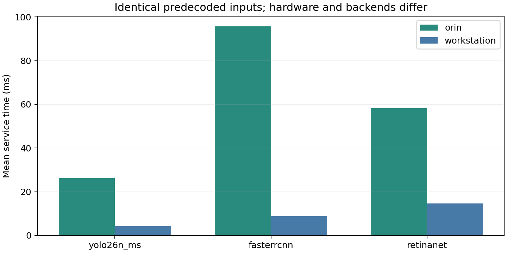

# Matched input deployment cost comparison

Three fixed576 detectors ran on the same 120 recorded indoor RGB/thermal pairs, with three fresh processes per detector and platform: 18 runs and 2,160 timed frames. Input arrays were decoded into host RAM before timing. H2D, backend transforms, inference, native-coordinate output conversion and synchronization remain timed. This is not end-to-end camera latency.

| Platform | Model | Backend | Mean service ms | Mean run p95 ms | Run-mean range ms | Energy/frame J | Energy scope |
|---|---|---|---:|---:|---:|---:|---|
| orin | fasterrcnn | tensorrt | 95.64 | 115.64 | 92.17–97.83 | 2.942 | Orin named-rail host sum; shared services included |
| orin | retinanet | tensorrt | 58.15 | 75.54 | 53.44–61.71 | 2.009 | Orin named-rail host sum; shared services included |
| orin | yolo26n_ms | tensorrt | 26.19 | 30.19 | 26.01–26.48 | 0.511 | Orin named-rail host sum; shared services included |
| workstation | fasterrcnn | pytorch | 8.89 | 9.65 | 8.78–8.95 | 2.312 | GPU device NVML total-energy delta |
| workstation | retinanet | pytorch | 14.64 | 15.39 | 14.52–14.78 | 3.896 | GPU device NVML total-energy delta |
| workstation | yolo26n_ms | pytorch | 4.19 | 5.53 | 3.97–4.37 | 0.447 | GPU device NVML total-energy delta |

## Interpretation

The deployments differ in both hardware and backend: Jetson AGX Orin uses previously validated TensorRT 10.3 FP32 engines; RTX 6000 Ada uses native FP32 PyTorch with the same frozen checkpoint identities. Four CPU threads and the first four cores within the permitted process affinity are used. No host power/clock settings or existing camera services were changed. The workstation cost jobs wait for the dataset evaluation to release their assigned GPU.

Do not interpret service-time differences as a pure hardware effect. Orin energy integrates named host rails including background activity; workstation energy is the NVML GPU-device total-energy counter delta. Those scopes differ, so no cross-platform energy-efficiency ratio is computed. Short 120-frame runs and three repetitions do not establish stable p99, unseen-scene behavior or model-only power. The clip is unannotated; this benchmark does not measure detection accuracy.

Input SHA-256 lists and ordering matched across all 18 runs, and every run contains 120 timed outputs with energy measurements. Warmup (12 fixed576 calls), model loading, prefetch and one idle second precede timing. The backend adapters retain their trained preprocessing; fixed long-side size does not imply identical tensor shape or kernel work.

Raw plans, per-frame detections/timings, Orin rail samples, source snapshots and launch logs: /media/imsel/4TBSSD/EMCH585_Artifacts/platform_comparison_20261123. Recreate the export using `python -m experiments.report_platform_cost --raw /path/to/raw --output /path/to/summary`.

