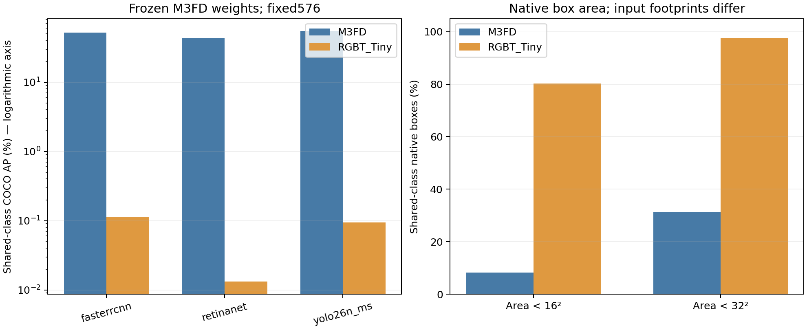

# RGBT-Tiny comparison with M3FD

Three frozen M3FD-trained detectors were evaluated at a 576-pixel input long side on the complete official RGBT-Tiny test split: 12,590 pairs across 30 sequences. The same saved M3FD test predictions were rescored on the shared bus, car and person classes. No RGBT-Tiny training, threshold fitting or checkpoint selection occurred.

| Model | M3FD shared-class AP % | RGBT-Tiny shared-class AP % | M3FD AP-small % | RGBT-Tiny AP-small % |
|---|---:|---:|---:|---:|
| fasterrcnn | 51.904 | 0.114 | 20.054 | 0.239 |
| retinanet | 43.793 | 0.013 | 4.740 | 0.032 |
| yolo26n_ms | 54.730 | 0.095 | 17.338 | 0.107 |

AP is standard COCO IoU .50:.95 with maxDets 1/10/100 and native annotation areas. It is distinct from the RGBT-Tiny SAFit metric. The source/target AP difference describes these checkpoints under transfer; it does not rank the intrinsic difficulty of two datasets or compare matched within-dataset training.

## Object scale and class distribution

| Shared-class test data | Paired images | Boxes | Area below 16² native pixels | Area below 32² native pixels | Mean boxes/image |
|---|---:|---:|---:|---:|---:|
| M3FD | 419 | 2,958 | 8.25% | 31.27% | 7.06 |
| RGBT_Tiny | 12,590 | 136,408 | 80.26% | 97.67% | 10.83 |

These are native-coordinate area thresholds. Native image dimensions differ across datasets; resizing changes the actual input-pixel footprint. Class frequencies, viewpoint, environment, calibration and annotation conventions also differ, so object size alone is not established as the cause of the transfer gap.

RGBT-Tiny has 46,701 paired images: 34,111 training pairs in 85 sequences and 12,590 test pairs in 30 disjoint sequence IDs. Eight DJI filename prefixes occur in both partitions; this suggests potentially related captures but does not prove recording identity. split_audit.json preserves that distinction. This frozen-transfer study never fits on either RGBT-Tiny partition. Any future target-training protocol should verify capture groups before selecting validation/test units. The frequently quoted roughly 93K frames counts the two modality frames. Our comparison uses original visible-modality 00 boxes with paired thermal-modality 01 images, rather than the local YOLO conversion, which clips some source boxes. Residual cross-camera parallax is not independently calibrated. All images remain in scope, including images without shared-class objects. Cyclist is not mapped to motorcycle; unmatched classes are excluded.

## Per-class accuracy

| Model | Dataset | Bus AP % | Car AP % | Person AP % |
|---|---|---:|---:|---:|
| fasterrcnn | M3FD | 60.693 | 50.921 | 44.099 |
| fasterrcnn | RGBT_Tiny | 0.021 | 0.320 | 0.001 |
| retinanet | M3FD | 56.304 | 41.010 | 34.064 |
| retinanet | RGBT_Tiny | 0.012 | 0.028 | 0.000 |
| yolo26n_ms | M3FD | 65.118 | 54.395 | 44.676 |
| yolo26n_ms | RGBT_Tiny | 0.000 | 0.284 | 0.000 |

## Interpretation and reproduction

This experiment establishes a frozen-transfer baseline for three architectures. A dataset-trained comparison requires separate training and validation within RGBT-Tiny, followed by an untouched evaluation protocol. This fixed576 accuracy study does not establish adaptive-controller performance on RGBT-Tiny or live latency, dropped-frame or energy results. Timings in the raw files are offline workstation service measurements.

The original frozen plan, checkpoint and annotation hashes are preserved. An older remote evaluator assumed six classes and failed while summarizing the shared-class source score; its source copy is retained in source_attempt1. The corrected evaluator handles noncontiguous category IDs. Completed Faster R-CNN native predictions were reused and rescored; remaining models used the same frozen settings. RESUME.json records source versions; no favorable test setting was chosen.

Run `python -m experiments.compare_rgbt_tiny` with the arguments in plan.json to reproduce into a new directory. Recreate this compact export with `python -m experiments.report_cross_dataset --raw /path/to/results --output /path/to/summary`. Full predictions, ground truth, image hashes, timings and logs remain outside Git at /media/imsel/4TBSSD/EMCH585_Artifacts/rgbt_tiny_comparison_20261123.

Source: [RGBT-Tiny official release](https://github.com/XinyiYing/RGBT-Tiny), Ying et al., *Visible-Thermal Tiny Object Detection: A Benchmark Dataset and Baselines*, TPAMI 2025. Existing data-access terms apply; a public-domain license is not assumed.

